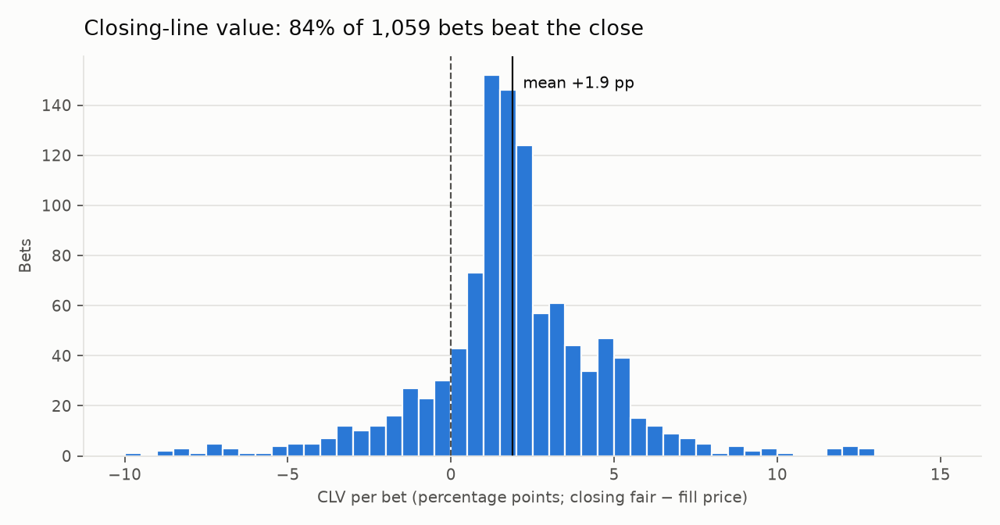
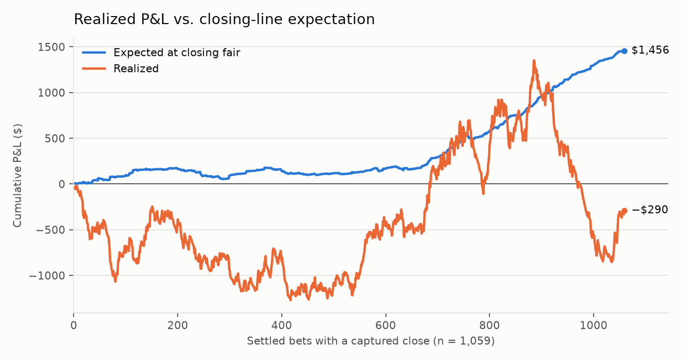

# prediction-market-ev-engine

A real-time engine that finds positive-expected-value bets on U.S. sports prediction markets (Kalshi, Polymarket US) by pricing them against Pinnacle, the sharpest sportsbook. It devigs Pinnacle's lines into fair probabilities, walks each prediction market's order book under that venue's actual fee model, sizes positions with fractional Kelly, and grades every bet against the closing line.

**Result:** across 1,116 paper bets, the engine beat Pinnacle's closing price by +1.9 percentage points on average (84% of bets); realized P&L is within normal variance.

## Results

Paper trading on a simulated $5,000 bankroll at quarter-Kelly (average stake $30). Fees are included in every stake. Data and record schemas are in [`1000BetsTracked/`](1000BetsTracked/).

| Metric | Value |
|---|---|
| Settled bets | 1,116 (Kalshi 531, Polymarket 585) |
| Total staked | $33,376 |
| Mean CLV (closing fair − fill price) | **+1.88 pp**, 95% CI [1.71, 2.05], n = 1,059 with a captured close |
| Bets that beat the closing line | **83.9%** |
| Expected profit at closing fair | +$1,456 (+4.5% of stake) |
| Realized P&L | −$353 (−1.1% of stake) |
| SD of total P&L under closing fair | ≈ $1,650 |
| Max drawdown | −$2,274 |

<picture>
  <source media="(prefers-color-scheme: dark)" srcset="docs/figures/clv_histogram_dark.png">
  
</picture>

<picture>
  <source media="(prefers-color-scheme: dark)" srcset="docs/figures/cumulative_pnl_dark.png">
  
</picture>

Both figures cover the 1,059 bets with a captured closing line (2 CLV outliers outside the −10 to +15 pp axis are omitted from the histogram).

**Why CLV is the primary metric.** Win/loss outcomes on ~1,100 bets are dominated by variance. If every bet were priced exactly at its closing fair, total P&L would have an expected value of +$1,456 and a standard deviation of about $1,650, so a 95% range of outcomes runs from roughly −$1,800 to +$4,700. The realized −$353 sits well inside that range. P&L alone cannot yet distinguish this strategy from break-even or from +4.5%. Closing-line value converges far faster. If a bet is priced better than the market's final consensus, it is +EV in expectation regardless of how the game ends. The CLV estimate is tight and well above zero, and the P&L shortfall is consistent with ordinary variance.

**By market type** (ROI is noisy at these sample sizes; CLV is the more reliable column):

| Market | Bets | ROI | Mean CLV |
|---|---|---|---|
| Total | 428 | −11.7% | +1.6 pp |
| Spread | 329 | +6.7% | +3.1 pp |
| Moneyline | 310 | −2.8% | +0.5 pp |
| Player prop | 36 | +5.6% | +5.5 pp |
| Team total | 13 | −44.3% | +4.6 pp |

## Verifying these results

- **Every number above recomputes from the raw log.** `python3 -m analysis.summarize_results` (standard library only) prints the headline table and the market-type breakdown directly from `1000BetsTracked/paper_settlements.jsonl`.
- **The raw records are public.** [`1000BetsTracked/`](1000BetsTracked/) holds every placement, closing-line capture, and settlement, with field definitions in its README.
- **Each bet can be checked against public data.** Every record carries the venue's market ID (e.g. Kalshi ticker `KXKBOSPREAD-26JUN070400KIWDOO-KIW3`), the placement timestamp, the fill price, and the order-book levels it walked. Kalshi and Polymarket publish market price and trade history, and game results are public, so any bet's price and outcome can be confirmed independently.
- **What cannot be verified.** These are paper fills recorded by the engine itself, and this snapshot was committed after the trading period ended, so it is not a pre-registered record. Pinnacle closing prices come from a paid API and are not independently reproducible.

## How it works

1. **Data collection.** Three pollers snapshot every venue to JSONL: Pinnacle every 15 s, Kalshi and Polymarket every 60 s, behind a shared rate gate with 429 backoff.
2. **Matching.** Each prediction-market contract is paired with its Pinnacle counterpart across moneylines, spreads, totals, team totals, half/period lines, and player props.
3. **Fair price.** Pinnacle's two-way price is devigged multiplicatively (implied probabilities rescaled to sum to 1), then shrunk toward less confidence by a variance-proportional haircut, `p − k·p(1−p)` with `k = 0.064`.
4. **Edge.** The scanner walks the contract's YES-ask ladder level by level, applies the venue's fee model (Kalshi 7%, Polymarket 3%), and keeps only fills that clear a per-(venue, market-type) edge floor: 2% for team markets and 4% for player props, where Pinnacle limits are low and quotes noisier.
5. **Sizing.** Quarter-Kelly on the haircut fair probability, capped per bet.
6. **Execution safety.** Signals come only from fresh snapshots (Pinnacle ≤ 30 s old), and every placement re-fetches Pinnacle live at decision time so a stale line never reaches an order.
7. **Grading.** Each open bet captures Pinnacle's closing fair near start time; settlement records P&L, CLV, and fair-line drift. All state is append-only and rebuilt by replay.
8. **Fill realism check.** About 2 s after each paper fill, the engine re-reads that market's order book and records how many of the claimed shares were still buyable at the same price or better. This is diagnostic only and never feeds back into sizing or placement.

The scanner targets the 0.5–3 h pregame window, where news-driven moves on Pinnacle reach prediction markets with exploitable lag, without competing against sub-second live-arbitrage bots.

## What the data changed

- **Kalshi basketball moneylines disabled:** −$517 over 61 bets, retaining only ~16% of placement edge by close.
- **Soccer moneylines disabled** on both venues after testing EV-negative in aggregate; other soccer markets are limited to a 14-league whitelist.
- **Calibration haircut:** `analysis/estimate_bias.py` measures the gap between placement fair and closing fair; `analysis/backtest_haircut.py` replayed every historical bet under the haircut before it was enabled.
- **Closing-capture window** widened to 15 minutes pre-start to reduce missed closes.

## Limitations

- **Paper fills.** Fills are simulated against the quoted ladder at decision time. Real fill rates, queue position, and slippage are untested at scale; the post-fill re-check (step 8) was added after the results period above to measure how much of each simulated fill was real liquidity.
- **One reference book.** All edge is measured relative to Pinnacle. If Pinnacle's own line is wrong in the same direction as the prediction market, the engine cannot see it.
- **Short window.** Seven weeks of data, concentrated in baseball (52% of bets). Differences between sports and market types are not yet statistically distinguishable.
- **Capacity.** Prediction-market depth at the quoted edge is thin; the average fill was about $30.

## Repository layout

| Path | Contents |
|---|---|
| `pmev/pollers/` | Pinnacle, Kalshi, and Polymarket snapshot pollers |
| `pmev/matching/` | Cross-venue matcher and the shared EV / ladder-walk math |
| `pmev/core/` | Devig, Pinnacle client, poller I/O and rate limiting |
| `pmev/engine.py` | Side-effect-free scan pipeline: freshness gate → match → ladder fetch → evaluate → rank |
| `pmev/execution/` | Paper-trading simulator and gated real-money tracker |
| `pmev/adapters/` | Per-venue normalization, fee models, and trade clients |
| `pmev/dashboard.py` | Flask dashboard (live EV, paper, real) |
| `analysis/` | Results summary and figures, bias estimation, haircut backtest, threshold sweeps, simulations |
| `1000BetsTracked/` | Static snapshot of the paper-trade history behind the results above |
| `deploy/` | systemd units (Linux/VPS) and launchd agents (always-on Mac) for the pollers and dashboard |
| `tests/` | Unit and integration tests (pytest) |

All tunables (enabled markets, edge floors, fee rates, bankroll and risk caps, timing) live in `pmev/config.py`.

## Running it

```bash
pip3 install requests flask
cp deploy/env.example .env            # set PINNACLE_API_KEY
python3 -m pmev.pollers.pinnacle      # each poller in its own shell
python3 -m pmev.pollers.kalshi
python3 -m pmev.pollers.polymarket
python3 -m pmev.dashboard             # http://127.0.0.1:5055
```

`python3 -m pmev.matching.ev` prints the single best current opportunity and exits. Real-money trading is off by default; it requires venue API keys and `REAL_TRADING_ENABLED=1`. To run the four services unattended, use `deploy/systemd/` on Linux (provisioned by `deploy/setup.sh`) or `deploy/launchd/` on macOS:

```bash
uv venv --python 3.12 .venv
uv pip install -p .venv requests flask cryptography numpy pytest
cp deploy/env.example .env && chmod 600 .env
./deploy/launchd/install.sh                  # loads all four agents; re-run after editing a plist
```

The launchd agents restart on crash and start at login; keep the machine from sleeping (`pmset -g | grep sleep`) or the pollers stall.
